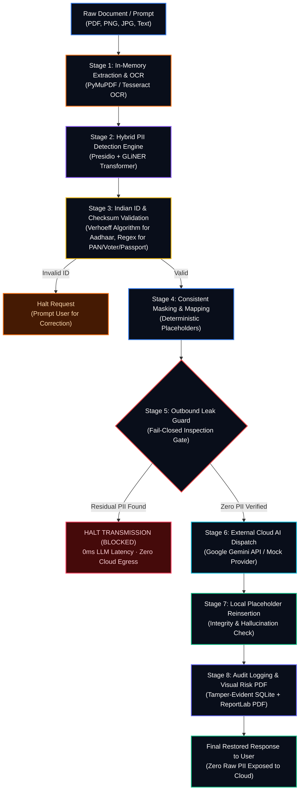

# Cybrix. — Enterprise Privacy Gateway for LLMs

> **Zero-Trust In-Memory Perimeter Intercepting Indian Identifiers & Documents Before Cloud AI Processing**

[](LICENSE)
[](https://fastapi.tiangolo.com/)
[](https://reactjs.org/)
[](https://microsoft.github.io/presidio/)
[](https://github.com/urchade/GLiNER)
[](#)

---

## 📌 Executive Summary

Modern enterprise adoption of Generative AI (LLMs) poses major data privacy, sovereignty, and compliance risks under data protection laws (e.g., India's **DPDP Act 2023**, GDPR). Transmitting raw identity cards, candidate resumes, loan applications, and customer support documents to external model APIs exposes personal data to third-party retention and training datasets.

**cybrix. Privacy Gateway** is a client-side and perimeter security gateway that intercepts prompts and documents locally:
- **100% In-Memory Processing**: Binary document bytes are parsed strictly in RAM (PyMuPDF / Tesseract OCR) and never stored on disk.
- **Multi-Engine PII Detection**: Hybrid pipeline combining Microsoft Presidio (checksums & pattern matching) with a compact local transformer (GLiNER) for context-aware Indian names and addresses.
- **Deterministic Placeholder Tokenization**: Replaces detected values with consistent `<TYPE_N>` tokens across long documents.
- **Fail-Closed Outbound Leak Guard**: Inspects outgoing payloads before external transmission; if residual sensitive data is detected, the request is immediately blocked (0ms LLM round-trip latency).
- **Client-Side Reinsertion**: Restores original values into the model's response inside local RAM.
- **Audit & Forensic Reporting**: Generates tamper-evident audit logs and downloadable Internal Risk Assessment PDFs with visual entity coordinate mapping.

---

## 🏗️ Technical Architecture

The gateway executes an **8-stage synchronous zero-trust pipeline**:



### The 8 Processing Stages

1. **Document Ingestion (In-Memory)**: Reads uploaded PDFs and image scans without saving binary bytes to disk. Extracts text using PyMuPDF native rendering or pre-processed adaptive Tesseract OCR.
2. **Hybrid Detection**:
   - **Pattern & Structured Recognizers (Presidio)**: Custom India recognizers for Aadhaar (UIDAI), PAN (Income Tax Dept), GSTIN, Indian Passports, Voter ID (EPIC), Phone numbers (+91), and Email addresses.
   - **Deep Named Entity Recognition (GLiNER)**: `urchade/gliner_multi_pii-v1` identifies multi-token Indian personal names and complex multi-line postal addresses.
3. **ID Validation (Fail-Fast Verification)**: Runs strict check-digit algorithms (e.g. Verhoeff algorithm for 12-digit Aadhaar numbers). Malformed or invalid IDs halt execution and request user correction.
4. **Consistent Token Masking**: Maps each unique entity to a deterministic typed token (e.g., `<PERSON_1>`, `<PAN_1>`). Re-occurrences across pages share the exact same placeholder token.
5. **Fail-Closed Outbound Leak Guard**: Scans the outgoing prompt against normalized representations of all extracted PII values. If any unmasked entity is detected, egress is immediately blocked.
6. **External AI Invocation**: Dispatches only sanitized, zero-PII prompts to external models (Google Gemini 2.5/3.8 Flash or Mock Provider).
7. **Reinsertion & Hallucination Guard**: Matches returned placeholder tokens in the AI output, restoring original values in memory. Flags dropped or invented tokens.
8. **Forensic Audit & Visual Risk Report**: Logs request metrics (excluding raw personal data) into SQLite and builds an internal multi-page Risk Assessment PDF featuring highlighted visual coordinate bounding boxes.

---

## 💻 Tech Stack

### **Backend (Python 3.11+ / FastAPI)**
- **Framework**: [FastAPI](https://fastapi.tiangolo.com/) + [Uvicorn](https://www.uvicorn.org/) (High-performance ASGI server)
- **PII Detection**: [Microsoft Presidio Analyzer](https://github.com/microsoft/presidio) & [GLiNER](https://github.com/urchade/GLiNER) (`urchade/gliner_multi_pii-v1`)
- **NLP & Tokenization**: [spaCy](https://spacy.io/) (`en_core_web_sm`)
- **Document Processing**: [PyMuPDF](https://pymupdf.readthedocs.io/) (`fitz`), [Tesseract OCR](https://github.com/tesseract-ocr/tesseract) (`pytesseract`), [Pillow](https://python-pillow.org/), [OpenCV](https://opencv.org/)
- **PDF Generation**: [ReportLab](https://www.reportlab.com/) (Confidential multi-page forensic risk assessment generation)
- **External AI Provider**: [Google GenAI SDK](https://github.com/googleapis/python-genai) (Google Gemini 2.5 / 3.8 Flash)
- **Testing**: [Pytest](https://docs.pytest.org/), [HTTPX](https://www.python-httpx.org/)

### **Frontend (React 18 / Vite)**
- **Framework**: [React 18](https://react.dev/) + [TypeScript](https://www.typescriptlang.org/)
- **Bundler & Tooling**: [Vite](https://vitejs.dev/)
- **Styling**: [Tailwind CSS](https://tailwindcss.com/) (Custom Cyberpunk Obsidian / Neon Orange enterprise theme)
- **Icons**: [Lucide React](https://lucide.dev/)
- **Routing**: Component-level state router supporting `/app`, `/app/new-request`, `/app/history`, `/app/audit-logs`, `/app/reports`

---

## ⚙️ Local Installation & Setup

### **Prerequisites**
- **Python**: Version 3.11, 3.12, or 3.13 installed (`python --version`)
- **Node.js**: Version 18+ or 20+ installed (`node --version`)
- **Git**: Installed (`git --version`)
- **Tesseract OCR (Optional for scanned images)**:
  - Windows: [UB-Mannheim Tesseract Installer](https://github.com/UB-Mannheim/tesseract/wiki) (Add to `PATH`)
  - Linux: `sudo apt-get install tesseract-ocr`
  - macOS: `brew install tesseract`

---

### **1. Clone Repository**

```bash
git clone https://github.com/knvijaykumar/chai.git
cd chai
```

---

### **2. Install Backend Dependencies**

Open a terminal at the project root (your cloned directory):

```bash
# Upgrade pip
python -m pip install --upgrade pip

# Install Python requirements
pip install -r requirements.txt

# Download required spaCy language model
python -m spacy download en_core_web_sm
```

*(Optional: If you prefer an isolated virtual environment)*:
```bash
python -m venv .venv
# Windows PowerShell:
.\.venv\Scripts\Activate.ps1
# Linux / macOS:
source .venv/bin/activate
pip install -r requirements.txt
```

---

### **3. Configure Environment Variables (`.env`)**

Create a `.env` file in the project root:

```env
GEMINI_API_KEY=your_google_gemini_api_key_here
GEMINI_MODEL=gemini-3.8-flash
```

> **Note**: If `GEMINI_API_KEY` is omitted, the gateway defaults to the offline **Mock Provider**, allowing 100% functionality without internet access or external API costs.

---

### **4. Install Frontend Dependencies**

```bash
cd frontend
npm install
cd ..
```

---

## 🚀 Running the Application

To run the complete application, **open two separate terminals**:

### **Terminal 1: Start the Python Backend**

```powershell
# Navigate to the project root
cd D:\test\ChaiGPT2

# Launch the FastAPI backend server
python -m uvicorn gateway.api:app --host 127.0.0.1 --port 8000 --reload
```

- **Backend API**: `http://127.0.0.1:8000`
- **Interactive Swagger Docs**: `http://127.0.0.1:8000/docs`
- **Health Check Endpoint**: `http://127.0.0.1:8000/health`

---

### **Terminal 2: Start the React Frontend**

```powershell
# Navigate to the frontend directory
cd D:\test\ChaiGPT2\frontend

# Start Vite development server
npm run dev
```

- **Enterprise Application Dashboard**: `http://localhost:5173/app`
- **New Request & Document Ingestion**: `http://localhost:5173/app/new-request`
- **Request Audit History**: `http://localhost:5173/app/history`
- **Public Product Landing Page**: `http://localhost:5173/`

> **Tip for Mobile / LAN Testing**: Run `npm run dev -- --host` to expose the UI to your local network.

---

## 🧪 Automated Testing & Verification

The project includes unit and concurrency test suites covering OCR, GLiNER NER, Indian checksums, leak blocking, and thread-safe PDF report generation:

```bash
# Run all tests
python -m pytest tests/ -v

# Run Document Extraction & OCR Pipeline tests (22 tests)
python -m pytest tests/test_document_processing.py -v

# Run Request Concurrency & Data Isolation tests
python -m pytest tests/test_document_concurrency.py -v

# Run Visual Risk Mapping & PDF Report generation tests (22 tests)
python -m pytest tests/test_pdf_reports.py -v

# Run Security Leak Guard drills & failure tests
python -m pytest tests/test_failures.py -v
```

---

## 📦 Production Frontend Build

To build the optimized static production bundle:

```bash
cd frontend
npm run build
```

Compiled assets will be output to `frontend/dist/`.

---

## 🔒 Security & Privacy Guarantee

1. **Zero Raw PII Egress**: External model payloads never contain raw names, PANs, Aadhaar numbers, phone numbers, or addresses.
2. **Fail-Closed Architecture**: If an unexpected token or residual PII is caught by the outbound leak guard, the transmission is aborted with 0ms LLM latency.
3. **No External Storage**: Source documents are processed in memory; no files or customer documents are written to disk.
4. **Tamper-Evident Audit Records**: The local audit log (`audit.db`) stores only cryptographic request IDs, token counts, and sanitized payloads—raw PII is never stored in logs.

---

## 📄 License

This project is licensed under the **MIT License**. See the [LICENSE](LICENSE) file for details.
